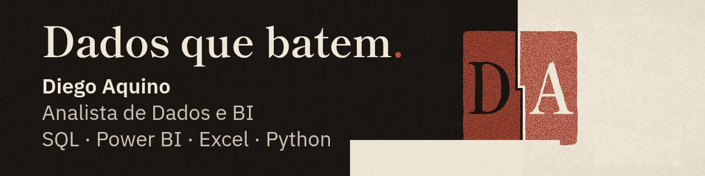

# Diego Aquino · Analista de Dados e Automação | IA aplicada

Fui professor de música e editor de áudio. Cansei de repetir tarefa e comecei a automatizar com Python. Desde então, acho o que é repetitivo e transformo em sistema.

Em e-commerce, cruzando dados fiscais com SQL, encontrei cerca de **R$ 80 mil em notas fiscais canceladas**. Hoje uno dados, automação e IA aplicada: **a IA interpreta, o código calcula e uma pessoa aprova.**

São Paulo, SP · [LinkedIn](https://linkedin.com/in/diegoaquino87) · diaquinotech@gmail.com

## Stack

**Python (pandas)** · **SQL** · **APIs REST / integração ERP (Bling)** · **LLM (Gemini, function calling)** · **Power BI (DAX, Power Query)** · **Excel avançado** · **ETL** · **Git/GitHub + CI**

Uso IA onde há texto, imagem e ambiguidade (contratos, DANFE por foto, análise de divergências), nunca no lugar de regra de negócio testada. Minha regra de trabalho: **IA para texto, imagem e ambiguidade; código para regra, dinheiro e validação determinística; humano para decisão crítica.**

## Projetos

Projetos de portfólio com dados fictícios ou públicos.

### Dados e BI

| # | Projeto | Foco | Testes e CI | Origem |
| :-: | :--- | :--- | :--- | :--- |
| 1 | [**inteligencia-de-compra**](https://github.com/diaquinodev/inteligencia-de-compra) | Painel Power BI gerado por código, modelo estrela em SQL, testes de qualidade de dados | 13 regras de qualidade em SQL; pytest coleta 57 casos; CI (ruff, mypy, sqlfluff e pytest; sem BigQuery e sem Power BI) | Projeto de portfólio (compras públicas da Base dos Dados, 2024 e 2025, no papel de histórico de um ERP) |
| 2 | [**dashboard-precificacao**](https://github.com/diaquinodev/dashboard-precificacao) · [demo](https://diaquinodev.github.io/dashboard-precificacao/) | Preço de venda e margem na Shopee, Mercado Livre (Clássico e Premium), TikTok Shop e Shein; comissão, taxas, frete e imposto | 32 testes de unidade e 13 fluxos de ponta a ponta; CI (ESLint, Prettier, tipos e Chrome) | Reescrita de ferramenta usada em consultorias de e-commerce; dados de exemplo fictícios |

### Automação

| # | Projeto | Foco | Testes e CI | Origem |
| :-: | :--- | :--- | :--- | :--- |
| 3 | [**auditor-de-repasses**](https://github.com/diaquinodev/auditor-de-repasses) | Python, Data Quality, validação, conciliação financeira, IA aplicada | 66 testes (pytest), ruff e mypy; CI | Projeto de portfólio (dados fictícios) |
| 4 | [**recebimento-fiscal**](https://github.com/diaquinodev/recebimento-fiscal) · [demo pública](https://recebimento-fiscal.streamlit.app) | FastAPI, Streamlit, SQLAlchemy, SOAP/WSDL, OCR/IDP de DANFE, Gemini com function calling via OpenRouter, guardrails em código, human-in-the-loop, evals | 73 testes (pytest, executados localmente), ruff e mypy no CI; CI | Projeto de portfólio (dados fictícios, SEFAZ simulado; camada de dados **ainda não executada contra Oracle**) |
| 5 | [**wms-bling**](https://github.com/diaquinodev/wms-bling) | Integração ERP (Bling API v3), APIs, analytics operacional | 7 testes (`node --test`); CI | Projeto de portfólio |
| 6 | [**radar-marketplace**](https://github.com/diaquinodev/radar-marketplace) | Extração de dados de mercado, inteligência de preços | 25 testes (pytest); CI | Projeto de portfólio |

### Dados e conciliação

| # | Projeto | Foco | Testes e CI | Origem |
| :-: | :--- | :--- | :--- | :--- |
| 7 | [**conciliacao-bancaria-automacao**](https://github.com/diaquinodev/conciliacao-bancaria-automacao) | Data Integration, SQL, Python, ETL, dados sintéticos (sem bancos reais) | 30 testes automatizados; CI (Python 3.12 e 3.13) | Projeto de portfólio (dados sintéticos) |

### Outros projetos

- [**estudio-fotos-marketplace**](https://github.com/diaquinodev/estudio-fotos-marketplace) — fotos de produto para marketplace (Full Stack + GenAI). O README registra 66 testes passando e 12 testes de banco pulados sem `TEST_DATABASE_URL`; o desenvolvimento está em pausa e o repositório segue como portfólio. Há um relato do autor sobre o contexto de origem.

## Em evolução: de dados para IA aplicada

Atuo com dados e automação em e-commerce desde 2023. Curso Ciência de Dados (UNINTER, conclusão em dez/2027) e estou aprofundando em agentes com LLM.

Em estudo (sem experiência profissional ainda):

- SQL avançado e modelagem de dados
- Databricks / PySpark (na faculdade)
- BigQuery (usado só em estudo, com dados públicos no projeto inteligencia-de-compra)
- IA aplicada e agentes autônomos: LLMs, function calling e orquestração de fluxos

## Contato

Pelo [LinkedIn](https://linkedin.com/in/diegoaquino87).
